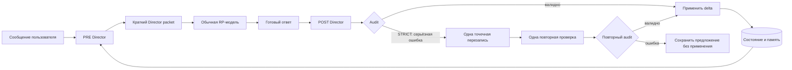

# Narrative Engine для SillyTavern

[English](README.md) | **Русский**


**Narrative Engine** — расширение для SillyTavern, которое добавляет к обычной ролевой модели отдельного **Режиссёра**. Ролевая модель по-прежнему пишет художественный ответ, а Режиссёр следит за непрерывностью сцены, состоянием персонажей, отношениями, знаниями, сюжетными линиями, событиями мира, долговременной памятью и спрайтами.

Проект не является форком SillyTavern и не подменяет его основной генератор. Он подключается через публичный API расширений и при необходимости использует отдельный серверный плагин для безопасного хранения ключа и SQLite.

> Версия **1.1.0**. Текущая локальная проверка: **295 клиентских и 135 серверных тестов**. Ранее совместимость изучалась по коду SillyTavern 1.19.0 (`06bde939fb1e9c4c8d8641d810f0a916b5bce127`). Проведены отдельные эксперименты с LLM и ComfyUI, но полная live-приёмка игрового цикла в SillyTavern остаётся незавершённой.

## Содержание

- [Что решает Narrative Engine](#что-решает-narrative-engine)
- [Как устроен один ход](#как-устроен-один-ход)
- [Профили и отдельные промпты состояний](#профили-и-отдельные-промпты-состояний)
- [Возможности](#возможности)
- [Установка расширения](#установка-расширения)
- [Выбор провайдера Режиссёра](#выбор-провайдера-режиссёра)
- [Установка серверного плагина](#установка-серверного-плагина)
- [Настройка](#настройка)
- [Состояние, память и восстановление](#состояние-память-и-восстановление)
- [Эмоции, отношения и мир](#эмоции-отношения-и-мир)
- [Память кампании и языки](#память-кампании-и-языки)
- [Обновление с предыдущих версий](#обновление-с-предыдущих-версий)
- [Спрайты, группы и VN-режим](#спрайты-группы-и-vn-режим)
- [Визуальный режиссёр и ComfyUI](#визуальный-режиссёр-и-comfyui)
- [Slash-команды](#slash-команды)
- [Безопасность](#безопасность)
- [Диагностика и устранение проблем](#диагностика-и-устранение-проблем)
- [Разработка и тестирование](#разработка-и-тестирование)
- [Ограничения](#ограничения)

## Что решает Narrative Engine

В длинной ролевой игре модель постепенно начинает забывать, где находятся персонажи, что на них надето, кто чем владеет, какие секреты кому известны и какие обещания ещё не выполнены. Увеличение контекста помогает лишь частично: старый диалог становится дорогим, содержит шум и не гарантирует последовательность.

Narrative Engine разделяет две задачи:

| Компонент | Ответственность |
| --- | --- |
| **RP-модель SillyTavern** | Пишет реплики, действия и художественный текст |
| **Director-модель** | Готовит краткий пакет фактов перед ответом и разбирает результат после ответа |
| **Структурированное состояние** | Хранит сцену, персонажей, время, предметы, отношения, знания и сюжетные линии |
| **Эпизодическая память** | Возвращает только релевантные старые события, а не весь архив чата |
| **Аудитор** | Ищет противоречия, телепортацию знаний, нарушение канона и управление персонажем пользователя |
| **Sprite Director** | Выбирает только существующий файл спрайта из предварительно отфильтрованного списка |

Главный принцип: **Режиссёр не пишет историю вместо RP-модели**. Он передаёт ей ограничения и подсказки, а после генерации сохраняет только подтверждённые изменения.

## Как устроен один ход



Обычный ход содержит:

1. **Один PRE-вызов** Режиссёра перед RP-генерацией.
2. **Один обычный вызов** RP-модели SillyTavern.
3. **Один POST-вызов** после получения полного ответа.

Профили состояния собираются в единый системный промпт и **не увеличивают число вызовов**. POST запускается после полного ответа, а не на каждом токене стриминга. В режиме строгого аудита допускается максимум одна точечная перезапись и одна повторная проверка.

Каждый асинхронный запрос привязан к чату, сессии и генерации. При переключении чата незавершённая работа отменяется, а запоздавший ответ не может изменить состояние другого чата. Если Режиссёр недоступен, основной RP-запрос продолжается без устаревшего пакета.

## Профили и отдельные промпты состояний

Да — для каждого состояния используется отдельный промпт. В каталоге [`prompts/states`](prompts/states) находятся 24 независимых фрагмента: восемь систем × три уровня строгости.

### Готовые профили

| Профиль | Для чего подходит | Акцент |
| --- | --- | --- |
| **Balanced** | Большинство ролевых игр | Ровный контроль всех систем |
| **Strict continuity** | Детектив, survival, сложная физическая сцена | Физическая непрерывность, знания и точная память |
| **Living world** | Кампания с расписаниями, NPC и событиями вне кадра | Сюжетные долги и причинное развитие мира |
| **Character driven** | Отношения, драма, визуальная новелла | Характер, отношения, знания и эмоции |
| **Custom** | Точная ручная настройка | Свой уровень для каждой из восьми систем |

### Уровни строгости

| Уровень | Поведение |
| --- | --- |
| **Light** | Фиксирует только крупные и очевидные изменения, почти не вмешивается |
| **Balanced** | Отслеживает значимые детали, но не превращает декоративный текст в факты |
| **Strict** | Требует текстового основания, жёстко соблюдает причинность и границы знаний |

В режиме **Custom** отдельно настраиваются Continuity, Character state, Relationships, Knowledge / secrets, Plot manager, World simulation, Memory retrieval и Sprite director. Профиль выбирается в **Extensions → Narrative Engine → Director profile**. Ручная матрица появляется только для Custom. Отключённая Story system не включается в собранный промпт.

Тексты можно осознанно редактировать в [`prompts/states`](prompts/states): для каждой системы есть `light.md`, `balanced.md` и `strict.md`. Изменения подхватываются после перезагрузки расширения или кнопки **Clear transient cache**.

## Возможности

### Непрерывность и состояние

- сцена, локация, присутствующие персонажи и внутриигровое время;
- позы, одежда, травмы, удерживаемые предметы и физические объекты;
- отношения между любыми парами персонажей;
- индивидуальные границы знаний, ложные убеждения и секреты;
- сюжетные линии, статусы, зависимости, дедлайны и narrative debt;
- планы NPC и события мира вне кадра;
- атомарные immutable-delta с источником и уверенностью;
- checkpoints и детерминированная перестройка после edit/delete/swipe.

### Память

- разрешённые сведения для участников сцены и получателей генерации;
- компактное состояние текущей сцены;
- Top-K поиск с фильтрами видимости, кампании, сессии, статуса и игрового времени;
- Unicode-поиск и опциональные embeddings с SQLite-кэшем, FTS5 и sqlite-vec;
- замещение устаревших фактов по factKey или supersedes с восстановлением при откате;
- ограниченный бюджет контекста вместо полного старого диалога.

### Аудит

Режиссёр проверяет положение, одежду, предметы, двери, хронологию, телепортацию персонажей и знаний, противоречия канону, выдуманные действия пользователя, резкий слом характера, забытые сюжетные обязательства и стагнацию.

Режимы:

- `off` — проверка не влияет на принятие ответа;
- `soft` — ошибка сохраняется в диагностике, некорректная delta не применяется;
- `strict` — для серьёзной ошибки разрешена одна минимальная перезапись с повторной проверкой.

## Установка расширения

1. Откройте **Extensions → Install extension**.
2. Вставьте адрес:

   ```text
   https://github.com/Gam1409/Narrative-Engine
   ```

3. Подтвердите установку и перезагрузите SillyTavern.
4. Откройте **Extensions → Narrative Engine**.
5. Выберите провайдера, его модель или Connection Profile и нужные Story systems.
6. Нажмите **Test connection**.
7. После успешной проверки включите **Enabled**.

Если доступ к репозиторию ограничен, среда, из которой SillyTavern устанавливает расширение, должна иметь соответствующие права. При ручной установке скопируйте содержимое репозитория в каталог пользовательских расширений SillyTavern.

## Выбор провайдера Режиссёра

| Provider | Когда использовать | Особенности |
| --- | --- | --- |
| **Server plugin** | Рекомендуемый вариант для удалённого API и постоянной установки | Ключ хранится только в env сервера, состояние — в SQLite |
| **OpenAI-compatible** | Локальный endpoint без авторизации | Прямой запрос браузера; endpoint должен разрешать CORS |
| **Ollama** | Локальная Ollama | Работает через локальный HTTP API |
| **SillyTavern connection profile** | OpenRouter, Anthropic, Custom endpoint и другие профили ST | Использует отдельный сохранённый профиль, не переключая основное RP-подключение |
| **Current SillyTavern connection** | Быстрая проба без отдельного endpoint | Использует текущую конфигурацию ST и зависит от её возможностей |

В браузерной части намеренно **нет поля API key**: `extensionSettings` сохраняются открытым текстом. Для сервиса с секретным ключом используйте Connection Profile SillyTavern или серверный плагин.

Рекомендуется отдельная модель, которая стабильно возвращает JSON и хорошо следует схеме. Температура Режиссёра по умолчанию низкая (`0.2`), потому что здесь важнее воспроизводимость.

### OpenRouter и другие Connection Profiles SillyTavern

Narrative Engine умеет выполнять PRE/POST через официальный `ConnectionManagerRequestService`. Режиссёр получает отдельный профиль, а основная RP-модель продолжает работать через своё текущее подключение.

Для OpenRouter:

1. В SillyTavern откройте **API Connections → Chat Completion → OpenRouter**.
2. Авторизуйте OpenRouter или сохраните API key средствами SillyTavern.
3. Выберите модель и нужный preset.
4. Сохраните настройку как **Connection Profile**, например `Narrative Director — OpenRouter`.
5. В Narrative Engine выберите provider **SillyTavern connection profile**.
6. Выберите созданный профиль в поле **Connection profile**.
7. Нажмите **Test connection**, затем включите движок.

Тем же способом поддерживаются Custom OpenAI-compatible endpoint, Anthropic и совместимые Text Completion профили. Конкретный набор определяется самим Connection Manager. Модель, URL, secret ID, generation preset, instruct preset и proxy берутся из выбранного профиля; Narrative Engine передаёт только сообщения Режиссёра, лимит ответа и безопасный override температуры.

Ключи не копируются в настройки Narrative Engine и не отображаются в списке: расширение хранит только ID профиля. Удаление выбранного профиля переводит подключение в понятное состояние ошибки, пока не будет выбран другой.

**Test connection** для профиля выполняет бесплатную локальную проверку наличия и совместимости профиля, но не отправляет тестовую генерацию, чтобы случайно не расходовать баланс. Первый реальный PRE-запрос остаётся фактической сетевой проверкой.

## Установка серверного плагина

Серверный плагин необязателен, но даёт безопасный proxy к Director API и постоянное SQLite-хранилище.

1. Скопируйте каталог [`server-plugin`](server-plugin) в `SillyTavern/plugins/narrative-engine`.
2. Установите runtime-зависимости:

   ```powershell
   cd SillyTavern/plugins/narrative-engine
   npm install --omit=dev
   ```

3. В конфигурации SillyTavern включите плагин:

   ```yaml
   enableServerPlugins: true
   ```

4. Задайте переменные окружения и перезапустите SillyTavern:

   ```text
   NARRATIVE_ENGINE_DIRECTOR_URL=https://director.example/v1
   NARRATIVE_ENGINE_DIRECTOR_MODEL=qwen3-coder-heretic
   NARRATIVE_ENGINE_DIRECTOR_API_KEY=your-secret
   ```

### Переменные окружения

| Переменная | По умолчанию | Назначение |
| --- | --- | --- |
| `NARRATIVE_ENGINE_DIRECTOR_URL` | пусто | Базовый OpenAI-compatible endpoint |
| `NARRATIVE_ENGINE_DIRECTOR_MODEL` | пусто | Модель Режиссёра |
| `NARRATIVE_ENGINE_DIRECTOR_API_KEY` | пусто | Секретный ключ; не отправляется в браузер |
| `NARRATIVE_ENGINE_EMBEDDING_URL` | пусто | Базовый OpenAI-compatible URL для embeddings; сервер добавляет `/embeddings` |
| `NARRATIVE_ENGINE_EMBEDDING_MODEL` | пусто | Модель embeddings с поддержкой нужных языков |
| `NARRATIVE_ENGINE_EMBEDDING_API_KEY` | пусто | Серверный ключ embeddings, если необходим |
| `NARRATIVE_ENGINE_COMFY_URL` | пусто | Фиксированный адрес ComfyUI |
| `NARRATIVE_ENGINE_COMFY_API_KEY` | пусто | Серверный ключ ComfyUI |
| `NARRATIVE_ENGINE_COMFY_WORKFLOWS` | пусто | Путь к JSON-файлу рецептов workflow |
| `NARRATIVE_ENGINE_VISUAL_JOB_TIMEOUT_MS` | `600000` | Общий срок задания, 10000–3600000 мс |
| `NARRATIVE_ENGINE_STORAGE_DIR` | `DATA_ROOT/_storage/narrative-engine` | Каталог SQLite |
| `NARRATIVE_ENGINE_TIMEOUT_MS` | `30000` | Timeout запроса, 1000–120000 мс |
| `NARRATIVE_ENGINE_RETRIES` | `2` | Число повторов, 0–5 |
| `NARRATIVE_ENGINE_BODY_LIMIT_BYTES` | `524288` | Лимит JSON-тела, 16 KiB–2 MiB |
| `NARRATIVE_ENGINE_RATE_LIMIT` | `60` | Запросов на окно |
| `NARRATIVE_ENGINE_RATE_WINDOW_MS` | `60000` | Длина окна rate limit |
| `NARRATIVE_ENGINE_DIRECTOR_ALLOW_HOSTS` | пусто | Разрешённые приватные hostnames через запятую |

Loopback endpoint разрешён для локальных моделей. Приватные и служебные адреса защищены от SSRF и требуют явного allowlist. URL провайдера берётся только из окружения сервера и не может быть подменён клиентским запросом.

## Настройка

Каждый Story system можно отключить отдельно. Это убирает соответствующие правила из промпта и запрещает применять его delta.

| Настройка Story rhythm | Диапазон | По умолчанию |
| --- | ---: | ---: |
| Memory Top-K | 1–20 | 6 |
| Plot interval | 1–50 | 3 |
| Memory consolidation | 2–100 | 8 |
| State checkpoint | 2–100 | 10 |
| Director packet budget | 500–2000 токенов | 1500 |
| PRE timeout | 1–120 секунд | 45 секунд |
| POST timeout | 1–180 секунд | 60 секунд |

При конфликте Режиссёр использует приоритет истины: принятое действие персонажа пользователя → свежий принятый чат → структурированное состояние → канон персонажа и мира → эпизодическая память → предположение Режиссёра. Предположение не должно незаметно превращаться в подтверждённый факт. Утверждение игрока о скрытых чувствах NPC не устанавливает эти чувства. Явные авторские изменения задаются командой `/narrative-edit-world`.

## Состояние, память и восстановление

В browser-режиме большие данные хранятся через `localforage`; в `chatMetadata` остаются компактное резюме, revision и ссылка на хранилище. В server-режиме используется SQLite в постоянном каталоге SillyTavern.

Для каждого принятого ответа сохраняется минимальная delta. Через заданный интервал создаётся checkpoint. После редактирования, удаления или swipe чат помечается dirty и может быть перестроен повторным применением подтверждённых delta.

В **Story record** можно просмотреть state, timeline, threads, memories и последний Director packet; выполнить rebuild; экспортировать или импортировать JSON. Импорт проверяется JSON Schema и должен относиться к тому же fingerprint чата.

## Эмоции, отношения и мир

Версия 0.7.0 отделяет оценку события, эмоции и долговременное отношение. У эмоции есть интенсивность, причина и затухание по игровому времени. Изменение отношения требует значимого события или повторяющихся однотипных взаимодействий; оно сохраняется с причинами и уверенностью. По умолчанию суммарное изменение одной направленной пары за ход ограничено 0.15.

В настройках **Inner life and world simulation** доступны:

- **off / light / full**: простые эмоции; настроение, оценки и ожидания; полная модель с телесным состоянием, скрытыми чувствами и отложенной обработкой;
- **minimal / standard / living**: игровое время; погода, освещение и события; дополнительно ежедневные планы NPC;
- пороги значимости и уверенности, число повторений, предел изменения отношений и границы длительности хода;
- **Show private state in author inspection** — показ внутреннего состояния в окнах просмотра. По умолчанию оно скрыто; экспорт всегда содержит полное состояние.

В режиме full значимое переживание назначает пересмотр на 08:00 следующего игрового дня. При скачке времени активному персонажу требуется новая оценка события; пропуск остаётся предложением для повторной обработки. Для этого нужна установленная игровая дата и время. Фоновые NPC получают облегчённые записи. События, реакции и планы сохраняются в SQLite либо браузерном хранилище и откатываются вместе с веткой чата.

Скрытая подсказка передаётся только текущему персонажу, в том числе в группе по публичному characterId SillyTavern. При неизвестном получателе или генерации за игрока она не добавляется. Остальным доступны только наблюдаемые проявления. Код проверяет причины, ссылки и ограничения; смысл события и согласованность реакции с характером оценивает Director.

[Настройки, пример авторского профиля, контракт и проверки этапа 4](reports/stage4_implementation.md). Планы NPC не перемещают физические сущности автоматически; условия событий пока поддерживают время и ссылку на одно событие-причину.

## Память кампании и языки

Перед поиском и отправкой текста в embedding API движок проверяет область памяти, видимость, статус и игровое время. Общий PRE-контекст содержит только сведения, разрешённые всем участникам сцены и фактическим получателям генерации. Эта проверка работает при `off`, `soft` и `strict`. Записи без явной видимости, спорные и замещённые факты не попадают в обычный поиск.

Без embeddings используется Unicode-поиск по словам и фрагментам слов, без русского словаря форм. Он подходит для совпадений в разных письменностях, но не обеспечивает перевод или полноценный смысловой поиск. Для поиска между языками настройте три переменные `NARRATIVE_ENGINE_EMBEDDING_*` и включите **Semantic memory search (server embeddings)**. Endpoint может отличаться от Director; к нему применяется тот же allowlist хостов.

Embeddings кэшируются по пользователю, чату, хэшу текста и модели. SQLite использует FTS5 и опциональный sqlite-vec; при отсутствии sqlite-vec сходство вычисляет клиент. При отказе embedding API поиск переходит на Unicode, а диагностика показывает `lexical_degraded`. Фильтры знаний сохраняются. Веса сходства, важности, персонажей, локации, давности и штрафа для истории доступны в **Memory ranking weights**. Первичная индексация требует запросов к модели; старые записи кэша автоматически не удаляются.

Область памяти задаётся **до первого принятого хода**:

```text
/narrative-configure-session {"mode":"campaign","campaignId":"my-campaign"}
```

Вызов без аргументов показывает `sessionId`. Для продолжения кампании в новом чате передайте этот ID:

```text
/narrative-configure-session {"mode":"campaign","campaignId":"my-campaign","fromSession":"ne-a1"}
```

Замените пример `ne-a1` фактическим ID. Источник должен принадлежать той же кампании и не иметь pending-ходов.

| Режим | Что переносится |
| --- | --- |
| `session_only` | Ничего из другой сессии; используется локальная память |
| `campaign` | Снимок состояния, отношений, памяти и открытых сюжетных линий |
| `selective` | Память и открытые линии по спискам `memoryIds`, `entities` или `types` |

Перенос создаёт снимок: последующие изменения исходного чата не переписывают новую сессию. Selective не копирует частичный граф физических сущностей. [Подробные примеры и измерения](reports/stage3_implementation.md).

## Обновление с предыдущих версий

Для перехода на 1.0.0 обновите расширение и серверный плагин, затем перезапустите SillyTavern. Визуальную генерацию включайте после настройки ComfyUI и файла workflow; без неё текстовые функции продолжают работать. Экспорт мира включает визуальные профили, но пока не включает очередь и файлы изображений.


Обновляйте расширение и серверный плагин вместе. После копирования обновлённого плагина выполните `npm ci --omit=dev` в его каталоге и перезапустите SillyTavern, затем перезагрузите страницу расширения.

История использует неизменяемые записи ходов и отдельные решения о статусах. SQLite создаёт резервную копию перед миграцией старой базы. Старые записи без привязки к ветке требуют повторного анализа актуального чата; если Director недоступен, они остаются pending. **Minimum confidence** задаёт порог принятия изменений (по умолчанию 0.5).

Состояние использует schemaVersion 2: собственник отделён от физического положения, доступны пользовательские типы и параметры. Зарегистрированные сущности меняются через типизированные `ops`; старые свободные карты сохранены. Явная авторская правка имеет формат `/narrative-edit-world {"reason":"...","ops":[...]}` и сохраняется с резервной копией. При pending-ходе можно исправить подтверждённый префикс и затем выполнить `/narrative-rebuild-state`.

**Reconnect storage** и `/narrative-reconnect-storage` восстанавливают подключение по проверенной локальной копии. При конфликте с серверной историей автоматической перезаписи нет. Если проверенной копии нет, движок сообщает об ошибке хранения.

- [История, миграция и восстановление — этап 1](reports/stage1_implementation.md).
- [Сущности, параметры и авторские операции — этап 2](reports/stage2_implementation.md).
- [Память, сессии и команды — этап 3](reports/stage3_implementation.md).

## Спрайты, группы и VN-режим

В Character Card можно добавить настройки:

```json
{
  "data": {
    "extensions": {
      "narrative_engine": {
        "spriteManifest": "https://example.test/kenzie-sprites.json",
        "stateDefaults": {},
        "directorHints": ["Kenzie hides fear behind dry humor."]
      }
    }
  }
}
```

Манифест может содержать тысячи вариантов. Код заранее фильтрует их по персонажу, костюму, семейству эмоций и позе; Режиссёр получает короткий список. Допустимый результат — точное имя файла из списка или `KEEP`.

Смена выполняется публичными командами Character Expressions `/expression-set` и `/costume`. В group chat фактический говорящий определяется по avatar/name сообщения. Выбор для одного персонажа не сбрасывает спрайты остальных.

## Визуальный режиссёр и ComfyUI

В версии 0.8.0 иллюстрация строится по принятому состоянию сцены и не меняет канон. Отдельные профили задают внешность, одежду, референсы, LoRA и допустимые позы/эмоции. Профили также участвуют в выборе спрайтов.

Генерация выключена по умолчанию. Для неё нужен серверный плагин, адрес `NARRATIVE_ENGINE_COMFY_URL` и файл рецептов `NARRATIVE_ENGINE_COMFY_WORKFLOWS`. В комплекте есть [пример workflow](server-plugin/examples/comfy-workflows.example.json): замените имя checkpoint на установленную модель. Затем включите **Visual director** и выберите `scene_full`.

- `/narrative-generate-illustration` ставит отдельное задание в очередь; текстовая игра продолжается.
- Автоматический режим реагирует на визуальные изменения сцены. Seed можно сохранять между кадрами.
- Кнопка просмотра визуальных заданий показывает готовые актуальные изображения. Результаты старой ветки помечаются устаревшими.
- Очередь хранится в SQLite и восстанавливается после перезапуска. Неоднозначно принятую отправку движок автоматически не повторяет.
- ControlNet, IP-Adapter, маски и частичная перерисовка требуют настроенного серверного workflow. Переключатели не устанавливают модели и узлы.

[Настройка, формат профилей и ограничения этапа 5](reports/stage5_implementation.md). Live-генерация, сохранение внешности и качество частичной перерисовки не проверялись. Визуальные профили и задания хранятся отдельно и не входят в экспорт канонического мира.

## Slash-команды

Все 18 команд используют полные английские имена **без алиасов**. Старые сокращённые имена больше не регистрируются; обновите свои макросы и Quick Replies.

| Команда | Назначение |
| --- | --- |
| `/narrative-engine on` / `/narrative-engine off` | Включить или выключить движок |
| `/narrative-configure-session` | Показать ID сессии и область памяти либо настроить новую сессию |
| `/narrative-edit-world` | Применить явную авторскую правку в формате `{reason,ops}` |
| `/narrative-show-registry` | Показать типы сущностей и определения параметров |
| `/narrative-show-state` | Показать структурированное состояние |
| `/narrative-show-threads` | Показать сюжетные линии |
| `/narrative-show-timeline` | Показать внутриигровое время |
| `/narrative-show-memory` | Показать сохранённую память автору |
| `/narrative-rebuild-state` | Восстановить актуальную ветку и повторить обработку pending-ходов |
| `/narrative-reconnect-storage` | Восстановить подключение к хранилищу с проверкой конфликтов |
| `/narrative-show-audit` | Показать последний audit |
| `/narrative-show-director-context` | Показать последний Director packet |
| `/narrative-refresh-sprites` | Повторить выбор спрайта последнего ответа |
| `/narrative-export-world` | Вернуть экспорт состояния в JSON |
| `/narrative-describe-scene` | Показать визуальное описание принятой сцены |
| `/narrative-set-visual-profile` | Сохранить визуальный профиль сущности из JSON |
| `/narrative-generate-illustration` | Поставить иллюстрацию в очередь ComfyUI |
| `/narrative-show-visual-jobs` | Показать задания и актуальность результатов |

Команды просмотра предназначены для автора и могут показывать закрытые сведения. Контекст персонажей формируется отдельно с фильтрацией знаний. Имена, справка и ответы команд — на английском; язык истории не ограничен.

## Безопасность

- API-ключи не попадают в `extensionSettings`, chat metadata, диагностику или логи.
- Сервер использует фиксированный endpoint из окружения, а не URL из запроса.
- DNS/IP-проверка блокирует защищённые сети без явного разрешения.
- Есть лимиты тела и ответа, rate limit, timeout и ограниченные retry.
- Клиентские system-фрагменты добавляются после неизменяемого серверного prompt; роли, число и размер сообщений валидируются.
- SQL-запросы параметризованы.
- Ответ модели не исполняется как JavaScript; JSON проходит извлечение, repair и Schema-валидацию.
- Серверные плагины SillyTavern не изолированы sandbox-механизмом — устанавливайте только проверенный код.

## Диагностика и устранение проблем

В **Director trace** видны статус провайдера, PRE/POST latency, сцена, время, персонажи, threads, retrieved memories, audit, спрайты, оценка токенов и безопасные ошибки.

### Director offline

- проверьте endpoint и модель;
- для browser endpoint проверьте CORS;
- для server provider проверьте env и `/api/plugins/narrative-engine/health`;
- перезапустите SillyTavern после изменения окружения.

### Server plugin route missing

- проверьте каталог `SillyTavern/plugins/narrative-engine`;
- установите зависимости внутри него;
- включите `enableServerPlugins: true`;
- перезапустите сервер, а не только вкладку браузера.

### Connection Profile отсутствует или не работает

- убедитесь, что встроенный Connection Manager включён;
- создайте профиль с поддерживаемым Chat Completion или Text Completion API;
- после изменения профиля выберите его заново в Narrative Engine;
- ошибка `401` означает, что ключ или авторизация профиля требуют обновления в SillyTavern;
- локальная проверка профиля не расходует токены, а реальное соединение проверяется первым PRE-запросом.

### Спрайт не меняется

- включите Character Expressions;
- проверьте sprite manifest и наличие файла в shortlist;
- помните, что при слабом изменении эмоции `KEEP` ожидаем;
- используйте `/narrative-refresh-sprites` для повторного выбора.

### State pending reconciliation

POST не был безопасно применён. Восстановите Director, выполните health check и запустите **Rebuild state** или `/narrative-rebuild-state`.

### Старые факты после edit/delete/swipe

Выполните `/narrative-rebuild-state`: движок восстановит checkpoint и повторно применит delta принятых сообщений.

Кнопка **Clear transient cache** очищает кэш базовых и модульных промптов и диагностику, но не удаляет постоянное состояние и память.

### Локальная приёмка 1.0.0

В Director trace добавлены доли невалидных ответов и строгих перезаписей, состояние подсистем и число pending-ходов. Счётчики охватывают время работы расширения; повторная обработка хода учитывается как отдельная попытка. Отсутствие измерений отображается как `null`.

`npm run test:golden` выполняет связанные проверки G1–G27 и сохраняет отчёт. [Каталог сценариев](tests/fixtures/golden-scenarios.json) содержит исходные реплики, ожидаемые результаты и ссылки на программные проверки. Это сценарии со смоделированными ответами Director, а не подтверждение качества живой модели и не готовый архив импортируемых чатов.

`npm run test:load` измеряет 3000 ходов, 300 сущностей, 30000 воспоминаний и сцену с шестью участниками. На текущем локальном прогоне медиана полного rebuild составила 4,27 с, поиска — 0,61 с. Три замера не являются гарантией производительности на другой машине.

[Отчёт этапа 6 и границы проверки](reports/stage6_implementation.md).

## Разработка и тестирование

Расширение требует Node.js 20+ для разработки. Серверный плагин заявляет Node.js 20, 22, 23 или 24; текущие проверки выполнены на Windows с Node.js 24.14.0. Серверным тестам нужны `better-sqlite3` и платформенный пакет sqlite-vec; клиентские тесты запускаются без них.

```powershell
npm ci --prefix server-plugin
npm test
npm run test:server
npm run check
npm pack --dry-run
```

Тесты покрывают атомарные delta, rollback, migrations, checkpoints/rebuild, retrieval на 1000 эпизодах, manifest на 2000 спрайтов, stale request gate, JSON repair, group speaker resolution, provider fallback, server routes, user scoping, SSRF, limits и реальный SQLite smoke test.

**Результат для 1.0.0:** 126 клиентских и 44 серверных теста. Проверены синтаксис JavaScript, JSON-схемы и упаковка. Набор включает фильтры знаний, откат замещённых фактов, перенос сессий, Unicode-поиск, изоляцию кэша и регистрацию команд без алиасов. [Сводка проверок](reports/stage6/checks.json). Live-проверки и качество реальной embedding-модели не измерялись.

Материалы проекта:

- [`reports/acceptance_matrix.md`](reports/acceptance_matrix.md) — матрица автоматической и live-приёмки;
- [`reports/st_upstream_preflight.md`](reports/st_upstream_preflight.md) — проверка API SillyTavern;
- [`reports/architecture_decisions.md`](reports/architecture_decisions.md) — архитектурные решения;
- [`reports/rooms_reference_analysis.md`](reports/rooms_reference_analysis.md) — анализ Rooms.

Upstream-источники:

- [SillyTavern](https://github.com/SillyTavern/SillyTavern/tree/release);
- [документация по расширениям](https://docs.sillytavern.app/for-contributors/writing-extensions/);
- [документация по server plugins](https://docs.sillytavern.app/for-contributors/server-plugins/);
- [Rooms](https://github.com/sigmareaver/rooms) — архитектурный референс без копирования кода.

## Доработка автоматизированной визуализации

В рабочей версии реализован первый этап: изменения и границы приёмки.

В **Visual Director** задаются текущий адрес ComfyUI, точное имя установленного checkpoint и профиль **SDXL**, **Pony** или **Illustrious**. Пустой адрес означает серверную настройку. Старые задания сохраняют свой адрес; серверный API-ключ не передаётся на другой адрес. Для частных сетей сохраняется серверный allowlist. Кнопка **Check ComfyUI models and nodes** читает модели и ноды без запуска GPU.

**Edit current character LoRA** сохраняет базовую внешность, файлы LoRA, веса, семейство и trigger words в `data.extensions.narrative_engine.visual`. Остальные поля карточки сохраняются. Привязка задаётся к ID персонажа мира; неоднозначные активные привязки отклоняются. Старые JSON-профили читаются, карточка имеет приоритет. При сохранении копии карточки редактор выдаёт ей новый визуальный UUID.

Встроенный `scene_full` работает для семейства SDXL без отдельного файла рецептов. Серверный пользовательский рецепт имеет приоритет. Неизвестная совместимость LoRA, неверное семейство или отсутствие подключённого слота останавливают задание. Для нескольких персонажей с LoRA требуется будущий региональный адаптер или отдельные спрайты. **Anima** использует отдельные рецепты `scene_anima`, `background_anima` и `sprite_anima`; SDXL-шаблон её не принимает.

Состояние надетых вещей теперь участвует в идентичности спрайта. Несовместимая одежда исключается из shortlist. Автозапросы ограничены интервалом (по умолчанию 15 секунд); устаревшие ожидающие автозадания заменяются. По умолчанию отправляется одно задание одновременно. Поздний или ошибочный результат не заменяет последние валидные визуальные метаданные. Визуальные профили включены в атомарный импорт/экспорт мира; задания и файлы изображений остаются внешними.

Добавлен второй этап — фон и прозрачные спрайты. Укажите **Background workflow** (встроенный `background`) и отдельный **Sprite workflow**, затем **Build current scene layers** / **Open visual novel scene**. Пустое поле спрайта означает только фон. Для автоматического режима включите **Automatic visual novel layers** вместе с автоматической генерацией. См. [контракт рецепта спрайта](server-plugin/examples/visual-layers.md).

PNG слоёв сохраняются в SQLite плагина отдельно по чатам и доступны после смены адреса ComfyUI. Эмоция и состояние одежды обновляют спрайт, сохраняя комнату. Сервер декодирует PNG и проверяет прозрачность; устаревшая одежда скрывается до получения замены. Квоты бинарных ресурсов: 256 MiB на чат и 1024 MiB суммарно (`NARRATIVE_ENGINE_VISUAL_ASSET_SCOPE_MB` / `NARRATIVE_ENGINE_VISUAL_ASSET_TOTAL_MB`). При заполнении новые ресурсы отклоняются, старые сохраняются. После обновления выполнить `npm install` в серверном плагине (добавлен pngjs) и перезапустить ST.

Проверки предыдущего этапа: **142 клиентских / 64 серверных тестов** и синтетический браузерный сценарий с очередью и SQLite. Live-качество моделей не проверено. Используется собственное окно сцены; моста в Character Expressions пока нет. Остаются общая пространственная постановка, conditioning иллюстрации сохранёнными слоями, проверка хэшей моделей и полная политика хранения истории/изображений. Необязательное LLM-направление и сжатие завершённых графов описаны ниже. При замене модели под тем же именем требуется новое имя либо версия рецепта. Компилятор использует принятый канон и, при включении настройки, ограниченное визуальное намерение LLM.

## Ограничения

Версия 1.1.0 не означает полной live-приёмки всех требований. [Итоговая сверка трёх ТЗ](reports/final_requirements_review.md) отдельно перечисляет реализованные механизмы, частичные контракты и непроверенные свойства. Импортируемые тестовые чаты исключены из согласованной локальной работы.


- Реальная модель может ошибаться при оценке событий и черт характера; локальные проверки подтверждают контракты и восстановление состояния, но не психологическое качество генерации.
- Фильтры ограничивают контекст, добавляемый Narrative Engine. Они не удаляют историю и карточки, которые SillyTavern самостоятельно передаёт RP-модели.
- Автоматическое замещение фактов требует factKey или supersedes; произвольные смысловые противоречия код не распознаёт.
- Качество delta зависит от способности Director-модели строго возвращать JSON.
- Движок снижает число противоречий, но не гарантирует художественную корректность любой внешней модели.
- Нестандартные sprite manifests могут потребовать адаптации полей.
- Автотесты не заменяют live-проверку с вашими карточками, World Info, group chat, VN layout и Character Expressions.
- Перед постоянной кампанией рекомендуется экспортировать состояние и проверить один тестовый чат.

## Структура проекта

```text
Narrative-Engine/
├─ index.js, manifest.json, settings.html, style.css
├─ src/
│  ├─ director/       # PRE/POST и модульные prompt bundles
│  ├─ runtime/        # жизненный цикл хода и диагностика
│  ├─ state/          # состояние, delta, timeline, checkpoints
│  ├─ memory/         # retrieval и browser/server storage
│  ├─ providers/      # ST profiles, OpenAI-compatible, Ollama, server proxy
│  ├─ sprites/        # manifests, shortlist и применение
│  ├─ visual/         # описание сцены, профили и клиент очереди ComfyUI
│  └─ ui/             # консоль настроек и действия
├─ prompts/states/    # 8 состояний × light/balanced/strict
├─ schemas/           # JSON Schema контрактов
├─ server-plugin/     # безопасный proxy и SQLite
├─ tests/             # клиентские тесты
└─ reports/           # проверка ТЗ и upstream
```

Лицензия: [MIT](LICENSE).


### Темп игры и цельные иллюстрации

Экспериментальный рецепт `scene_integrated` создаёт цельную сцену и отдельные проходы идентичности для максимум двух персонажей. Рецепты `background_integrated` и `sprite_integrated` используют выбранную общую стилистику; спрайтам нужны ноды и модель BiRefNet. Для Anima задаются точные имена diffusion model, текстового энкодера и VAE; SDXL-семейство использует checkpoint. Геометрия, детали одежды и точность действий пока не гарантируются. Для настраиваемых рецептов цельной иллюстрации доступен необязательный апскейл с img2img; визуальный контроль качества ещё не реализован.

Автоматические иллюстрации по умолчанию создаются при значимых изменениях: локация/окружение, состав персонажей, внешность, одежда или предметы. Только эмоция, поза или положение не запускают полный кадр. **Every visual change** возвращает прежнее поведение, **Manual only** оставляет ручные иллюстрации. В режиме слоёв обновляются только изменившиеся ресурсы, а полные иллюстрации запрашиваются вручную. Ручной запрос обходит фильтр значимости. Неудачный автоматический слой не запускается снова при каждой реплике: повтор возможен после изменения входных данных или через **Build current scene layers**. Автоматического цикла визуальных исправлений нет.

Генерация не ожидается в обработчике принятого хода. Несовместимый старый костюм скрывается, готовый неизменившийся фон сохраняется. Диагностика заданий разделяет очередь, обработку и общее время, включая опрос и передачу данных; это не чистое время GPU. Сцена показывает время готовности метаданных слоёв без LLM и декодирования картинки браузером. См. результаты живого замера и ограничения. Последние локальные проверки: **146 клиентских / 82 серверных теста**.


Для отдельных иллюстраций в интегрированном рецепте можно включить `detail: {"scale": 1.5, "denoise": 0.16}`. Проход сохраняет исходник для сравнения, увеличивает изображение и выполняет осторожную перерисовку с отдельными LoRA персонажей. По умолчанию выключен, требует дополнительного времени GPU и не гарантирует неизменность одежды или исправление геометрии. См. [настройку рецепта](server-plugin/examples/visual-layers.md) и оценку результатов.


### Локальная смена мимики спрайтов

Включите **Preserve sprite clothing when changing expressions**, выберите `sprite_integrated` и укажите установленный детектор лица. Видимая эмоция из принятого состояния LLM-режиссёра запускает локальное изменение лица; расширение само выбирает опорный спрайт по идентичности, одежде/состоянию и позе. Лицо первого спрайта определяется автоматически. **Inspect / adjust sprite face anchors** — запасной редактор для коррекции; без детектора можно выбрать лицо вручную. Смена одежды или позы требует новой основы. После генерации пиксели вне выбранной области лица и вся исходная прозрачность восстанавливаются точно.

Установка модели и ноды для аниме: [инструкция ComfyUI](comfy-node/README.md). В тесте сработал `lbpcascade_animeface.xml`; поддерживается и штатный MediaPipe, но на данном спрайте он лица не нашёл. Пустая или неоднозначная детекция отображается предупреждением, координаты не угадываются. Живые замеры и границы проверки: локальная смена эмоции заняла 10,5–12,4 с без браузера/LLM. Сохранность пикселей проверена, общее качество рисунка и полный сценарий в интерфейсе ST ещё не подтверждены.

### Компактная визуальная режиссура LLM

Настройка **LLM visual direction** (выключена по умолчанию) использует настроенного провайдера Режиссёра для выбора ограниченных признаков мимики и ракурса иллюстрации. Одежда, позы, свет, предметы, внешность и LoRA остаются из канона; ручной ракурс имеет приоритет. Фон не зависит от мимики. Нет автоматической смены позы или освещения.

Решения переиспользуются в пределах текущего экземпляра расширения (до 32 сцен); одновременные запросы объединяются. Кэш учитывает чат, сцену, профиль и экземпляр провайдера, а ссылка на ход и версия канона берутся заново. Неизвестные поля/значения отклоняются, отсутствующий ракурс означает сохранение текущего. Ошибочный ответ блокирует визуальную заявку и не повторяется при каждом опросе; для новой попытки можно пересоздать экземпляр расширения. Конечный словарь ограничивает содержимое, но не доказывает смысловую точность каждой выбранной мимики.

Проверки: 152 клиентских / 82 серверных теста. Прямой Qwen smoke: 3/3 ответа, 1,65–2,04 с, без ComfyUI. В диагностике отключено reasoning через параметры API; рабочий провайдер сохраняет свои настройки, поэтому его задержка может отличаться. Полный цикл браузера SillyTavern с этой настройкой ещё не проверен. Отчёт.

Визуальный контракт не привязан к Qwen: общий промпт объясняет дальнейшую генерацию изображения, без `/no_think`; принимается JSON или целый JSON-блок Markdown, с прежней строгой проверкой полей. Смена модели/endpoint/профиля провайдера инвалидирует кэш решений. A/B на Qwen: с пояснением цели 4/4 пригодных ответов против 1/4 без него, но среднее время выросло с 2,42 до 3,11 с. Выборка мала; другие LLM пока не проверены вживую. Клиентских тестов: 155. Сравнение.

Самостоятельная RP-проверка: 3/4 хода приняты, четвёртый остановлен из-за некорректного доказательства события. Добавлена одна попытка исправления извлечения до commit и защита при смене chatId в том же объекте контекста. Клиентских тестов: 159. Это стенд без установленного ST, не завершённая игровая приёмка. Отчёт.

Проверка понимания пользовательской истории: 20/20 ответов формально валидны, но найдены смысловые ошибки — перенос одежды из воспоминаний, неверные позы, чашка из кафе на улице. Два параллельных запроса: медиана 49,21 с, p95 56,42 с. Это независимый семантический стенд, не накопительный ST-прогон. Повтор настоящей цепочки runtime принял 3/4 хода; последний отклонён по enum памяти. Добавлены точные evidence.ref и уточнения POST по времени/причинам эмоций. 164 клиентских теста прошли. Русский разбор.

Эксперимент с типизированными командами состояния: 39/40 ответов Qwen 27B совпали с зафиксированными конечными состояниями; один ответ отклонён из-за JSON. Для восьми коротких RP-ходов медиана 4,10 с. Синтетическая выборка, один проход, фиксированные начальные состояния; сложная психология и накопление ошибок не проверены. Контракт ещё не включён в runtime. Методика, результаты и ограничения.

Для длинных сессий добавлено сжатие истории визуальных задач: раз в минуту удаляются workflow-графы максимум 50 завершённых записей старше 24 часов, кроме последних 100 задач каждого чата. Статусы, ключи защиты от повторной генерации, промпты и изображения сохраняются; активные и неоднозначные отправки не затрагиваются. Это не общий лимит БД. Настройки `NARRATIVE_ENGINE_VISUAL_GRAPH_COMPACTION=false`, `NARRATIVE_ENGINE_VISUAL_GRAPH_RETENTION_HOURS`, `NARRATIVE_ENGINE_VISUAL_GRAPH_KEEP_RECENT`. 85 серверных тестов прошли, включая 3000 заданий без GPU. Подробности и ограничения.

### Импорт workflow и маршрутизация промптов

В настройках Visual Director можно импортировать ComfyUI **API JSON** или рецепт с привязками, отдельно для иллюстраций, фонов и спрайтов. Необязательный просмотр графа показывает ноды и связи; выбор ноды позволяет назначить вход позитивного или негативного промпта. Четыре чипа вставляют скомпилированный позитив сцены, негатив сцены, пользовательский позитив и негатив. Порядок чипов и обычный текст сохраняются. Режиссёр описывает сцену, а назначение входов выполняется детерминированно и не зависит от поставщика LLM.

В настройках хранится до 8 рецептов: до 128 КиБ каждый, до 384 КиБ суммарно. Обычный редакторский JSON ComfyUI сначала нужно экспортировать в API-формате. Соединения графа доступны для просмотра; автоматической маршрутизации отдельных персонажей/регионов пока нет. Сервер проверяет привязки, а перед отправкой задания — модели и ноды. Импорт не расходует GPU.

Anima получила отдельные поля diffusion model, текстового энкодера и VAE, варианты Base/Preview (30 шагов, CFG 4), Aesthetic (30, 4) и Turbo (10, 1) для встроенных рецептов. Импортированные workflow сохраняют свои настройки семплера. Отдельная кнопка выбирает три Anima-workflow без включения автогенерации и скачивания моделей.

Локальная проверка: **168 клиентских / 89 серверных тестов**, браузерные проверки сохранения, назначения промптов, просмотра графа и узкой раскладки. Live-проверка в SillyTavern и на GPU не проводилась. Отчёт по UI.

Путь настройки своего графа: **Visual Director → Workflows for each image type → Import workflow JSON → Edit inputs and chips → View graph and choose prompt inputs**. Для знакомства можно импортировать [пример рецепта](server-plugin/examples/importable-illustration.json); перед генерацией замените пример имени checkpoint на установленную модель. Соединения редактируются в ComfyUI. Чипы: `{{positive}}`, `{{negative}}`, `{{userPositive}}`, `{{userNegative}}`. Позитив и негатив сцены — результат компилятора, а не непроверенный сырой ответ LLM.

В библиотеке импортированных workflow доступна кнопка **Check selected workflow (no generation)**. Она обновляет inventory ComfyUI и проверяет сохранённые входы, связи, наличие нод/моделей и выбранный checkpoint. Задания и загрузки изображений не создаются. Это не полная валидация исполнения ComfyUI: динамические привязки сцены и LoRA персонажей проверяются при генерации. Выключенный сервер означает «не проверено».

Для UI проверки workflow пройдены девять браузерных сценариев на настоящих модулях интерфейса с контролируемыми ответами: успех, ошибки, выключенный сервер, устаревшие настройки, перекрывающиеся запросы, неверный ответ и закрытие интерфейса. Локальный предпросмотр: `node server-plugin/scripts/settings-preview.cjs`; сценарии — [workflow-check.js](tests/browser/workflow-check.js). Обращений к ComfyUI нет.

### Стабильные фоны — локальная реализация

Настройка **Background updates** по умолчанию использует `location`: изменения переносимых предметов, эмоций, поз, одежды, погоды и формулировок света сохраняют комнату. Идентичность окружения включает публичное имя/свойства локации и явно помеченные постоянные предметы. Мебель задаётся в описании локации либо параметром сущности `backgroundRole: fixture` (параметр нужно объявить в реестре). Переносимые предметы остаются в промпте иллюстрации, но исключаются из фонового. Изменение постоянного предмета или публичных свойств комнаты обновляет фон.

`location_atmosphere` учитывает устойчивую смену дня/погоды: по умолчанию 2 разных принятых хода, настройка 1–10. Приоритет у игрового `timeline.time`, затем словарь ru/en. Границы по умолчанию 05/08/18/21 находятся в `src/visual/background.js`. Лампы/свечи дают `indoor`. Неизвестная атмосфера сохраняет картинку и сбрасывает незавершённый переход. `any` реагирует на сырой текст света/погоды, но тоже не учитывает переносимые предметы. **Regenerate background only** обходит кулдаун, меняет seed фона и не отправляет задания спрайтов.

Публичные входы фона закрепляются вместе с ключом в метаданных чата. Возврат в сохранённую комнату использует готовый ассет. Версия ключа повышена до 6 только для фонов; ключи спрайтов сохранены. На запись хранится 64 состояния наблюдения ходов, до 128 сочетаний локации/настроек и 64 вариантов на запись. Более глубокий откат заново инициализирует наблюдения атмосферы.

Миграция старых фонов консервативная: внутри того же чата новые настройки должны воспроизвести сохранённый старый граф, а локация — совпасть. Проверенный ассет получает серверную привязку к новому ключу без GPU. Просматривается до 1000 последних завершённых фоновых заданий. Если граф очищен или отсутствует, соответствие не доказано и возможна новая генерация. Старое изображение может содержать предметы; ручное обновление заменит его фоном по новой политике. Это частичная приёмка миграции, а не гарантия отсутствия генераций во всех старых чатах.

Локально проверены 30 изменений → одно фоновое задание, возврат A → B → A, гистерезис, неизвестные значения, откат/перезагрузка, исключение приватного состояния, ручное обновление и миграция в пределах чата. Live-приёмка на GPU и в полном SillyTavern не проводилась. Предпросмотр композита реализован ниже; иллюстрация из слоёв добавляется отдельными этапами.

### Предпросмотр композиции без GPU

Откройте **Visual novel scene → View → Composition preview (no GPU)**. Готовый фон и актуальные спрайты собираются на canvas с пропорциями исходного фона и сохранением прозрачности. Один персонаж — по центру, два — слева/справа в порядке сцены. Для предпросмотра доступны полный рост, средний и широкий кадр; настройки генерации и канон не меняются. Средний кадр может обрезать нижнюю часть тела; широкие спрайты ограничиваются по ширине без растяжения.

Отсутствующий/устаревший слой, изменившийся канон или более двух персонажей блокируют предпросмотр композиции. Обычный VN-просмотрщик сохранён. Это проверка расположения, а не сгенерированная иллюстрация: свет, перспектива, перекрытия передним планом и анатомия не исправляются. Серверный рецепт генерации по слоям использует тот же версионированный контракт раскладки; совпадение с браузером проверяется тестом.


### Иллюстрация из слоёв: серверная основа

Встроенный API-рецепт `scene_layered` собирает сохранённый фон и до двух прозрачных спрайтов, сохраняет композит в ноде 901 и уточняет целый кадр с denoise 0.45 (диапазон 0.35–0.55). Для двух персонажей используются отдельные ветви LoRA и маски по альфе соответствующих спрайтов на холсте. Итоговый выход — только нода 900. Совмещение с проходом детализации/увеличения пока запрещено.

Клиент передаёт ID ресурсов и ожидаемые ключи ресурсов из того же чата. Сервер определяет имена файлов и раскладку, переносит PNG без изменения байтов на выбранный ComfyUI и проверяет наличие нод/моделей до отправки задания на генерацию. Отсутствующие или неподходящие ресурсы дают ошибку; скрытой замены генерацией с нуля нет. См. [контракт API](server-plugin/examples/visual-layers.md#layer-guidance-server-api).

В разделе **Illustration continuity** доступны три источника: новый кадр (по умолчанию), текущие слои и слои с явно разрешённым переходом к новому кадру. Режим слоёв использует отдельный встроенный рецепт. Выбранный workflow иллюстрации/частичного обновления и дополнительные стадии conditioning применяются только к новому кадру. Для персонажей предварительно выберите workflow фона и прозрачного спрайта.

При строгом использовании слоёв **Missing layers** позволяет сразу вернуть ошибку либо достроить недостающие слои в фоне (по умолчанию 120 секунд, диапазон 10–600 секунд). Готовые слои используются повторно. Смена сцены/канона, настроек или запланированных слоёв прекращает ожидание. После перезагрузки ожидавший запрос отменяется: его нужно повторить вручную. Статус ожидания и ошибки видны в VN-просмотрщике. Ошибка слоя или таймаут не запускают генерацию с нуля; это допускает только явно выбранный режим fallback, с сохранением причины в задании и галерее.

Перед отправкой и публикацией клиент проверяет текущие ID/ключи референсов, сцену и настройки. Ручная замена фона, переодевание или замена спрайта не позволят прежнему результату стать текущим. Эти условия проверены локально; качество изображения, сохранение одежды, свет и перекрытия требуют отдельной GPU-приёмки.


### Диагностика визуальных заданий

**Visual task counters (no GPU)** читает SQLite текущего авторизованного чата. По фонам, спрайтам, иллюстрациям и локальной мимике отдельно показаны задания без кэша, попытки отправки, завершения, окончательные ошибки и попадания в кэш. Неоднозначная отправка считается попыткой; это не секунды GPU и не стоимость. Попадания в кэш учитываются по уникальному ключу запроса с момента установки функции: исторические попадания восстановить нельзя.

**Illustration from current layers** делает строгий ручной запрос из слоёв, не меняя сохранённый режим источника. Требования готовности и ожидания сохраняются. Результат содержит `guided`, ID референсов и `reason` для нового кадра; прежние поля источника/fallback сохранены для совместимости. Клиентские ключи учитывают версию рецепта и раскладки (1).

Локальная приёмка включает 30 ходов через клиент и SQLite: одна отправка фона, 29 попаданий в кэш и одна значимая иллюстрация; ответы GPU имитируются. Полный граф проходит типизированный тестовый инвентарь нод, отсутствующие зависимости отклоняются. Реальное качество ComfyUI и приёмка в SillyTavern ещё не проверены.


### Окно настроек

В панели расширений раскройте Narrative Engine и нажмите **Show settings / Показать настройки**. Настройки открываются в отдельном окне на 80% экрана: **Основные**, **Память и ритм**, **История**, **Персонажи и мир**, **Визуализация**, **Диагностика**. На узком экране окно занимает почти всю доступную область. Вкладки поддерживают стрелки, Home и End; Escape закрывает окно. Переключение вкладок не пересоздаёт поля. Настройки сохраняются существующим механизмом при изменении, отдельной кнопки сохранения нет.

По умолчанию настройки открываются на английском. Переключатель **Interface language / Язык интерфейса → English / Русский** меняет постоянные подписи и вкладки; выбор сохраняется. Язык RP, пользовательские промпты, ответы сервера и диагностические данные не переводятся. **Пресет генерации** объединяет граф ComfyUI с параметрами генерации и привязками входов.

### Самостоятельность RP-модели (включается явно)

Настройка **RP model autonomy / Самостоятельность RP-модели** находится во вкладке **Memory & pacing / Память и ритм**. По умолчанию выключена, сохраняя прежнее поведение. RP-модель выбирает действия NPC и пишет прозу; Режиссёр может передать наблюдение о сцене из закрытого словаря, но не сюжетные шаги. Обязательная непрерывность берётся из подтверждённого состояния с фильтрацией видимости, а не из предположений Режиссёра. Приватный контекст доступен только определённому получателю.

При включении даже Strict-аудит не заменяет показанный RP-текст текстом Режиссёра. Спорное извлечение остаётся неподтверждённым; диагностика предлагает проверить аудит и при необходимости вручную перегенерировать ответ в SillyTavern. Исправление JSON сохраняется. Дополнительный обязательный вызов модели не добавляется.

В диагностике **Сборка пакета** видны включённые, сжатые и отброшенные блоки. Обязательные факты сжимаются без обрезания перед добавлением менее приоритетного контекста. Если они всё равно превышают бюджет, частичный пакет не вставляется, показывается переполнение; RP может продолжиться без пакета NE. Оценка токенов приблизительная: число символов / 4. При отказе Режиссёра используется канонический контекст, если запрос ещё актуален. Выключение настройки возвращает прежнее поведение.

Это первый этап контрактов; ниже описаны добавленные базовые функции AntiSlop и лора. Полные требования к ним и новая фоновая жизнь NPC ещё не закрыты. Проверки локальные; живая приёмка Solo/Group/streaming и художественного результата остаётся открытой. Адаптера автоматической RP-регенерации пока нет.

### Наблюдение за повторами (локально)

Во вкладке **Память и ритм** выберите **Наблюдение за повторами → Только наблюдение**. По умолчанию выключено. Окно — 4–12 подтверждённых ответов (по умолчанию 6). Диагностика сравнивает последний ответ с предыдущими: одно совпадение даёт предварительный сигнал, два и более — подтверждённый статистический сигнал, а не литературный вердикт. Используются нормализованные Unicode-фрагменты по 32 символа; ответы короче 80 нормализованных символов пропускаются, анализ ограничен первыми 12 000 символами ответа. Порог совпадения 0.45 предварительный и требует калибровки на реальном RP.

Анализируется только подтверждённый префикс текущей ветки. Сигналы пересчитываются при сверке истории, исчезают при отсутствии повторов в новом ответе и сбрасываются при изменении истории/чата. В диагностике только ID свидетельств и коэффициенты, без копирования прозы. Наблюдение не меняет промпты PRE/POST, RP-текст или канон и не вызывает LLM/GPU. Семантический застой, интерпретация жестов и переписывание текста не реализованы. Необязательная мягкая обратная связь описана ниже.

### Мягкая обратная связь о повторах

Выберите **Наблюдение за повторами → Мягкая обратная связь** и включите **Самостоятельность RP-модели**. Без этой настройки остаётся только наблюдение, причина видна в диагностике. Подтверждённый локальный сигнал может добавить одну фиксированную необязательную подсказку в контекст RP. Она не цитирует повтор, не предписывает действия NPC и не пишет в канон. Приоритет блока самый низкий: если бюджета нет, подсказка отбрасывается. Нового LLM-вызова нет.

Подсказка действует максимум два новых подтверждённых ответа; следующий запуск возможен через три. Улучшение текста завершает её раньше. Смена сцены завершает старую подсказку и запускает паузу в три ответа. Edit/swipe/delete, смена чата и настроек анализа очищают её. Подсказки временные: перезапуск сбрасывает историю TTL/cooldown, следующая сверка может создать новую по текущей подтверждённой ветке. Повторный PRE без принятого ответа не расходует срок. Диагностика показывает срок и доступность, «Сборка пакета» — фактическое включение. Художественный эффект в живой игре пока не измерен.

### Лор мира: первый импорт World Info

Вкладка **Лор** импортирует SillyTavern World Info JSON: entries как объект/массив, допускается UTF-8 BOM. Нужно обновить серверный плагин вместе с расширением. Укажите ID библиотеки, выберите файл, проверьте предпросмотр, отметьте публичные записи и сохраните. Неотмеченные остаются скрытыми. Повторный импорт задаёт видимость заново по выбранным флажкам, заменяет совпадающие ID и помечает исчезнувшие записи устаревшими. Библиотеки хранятся в отдельных JSON-файлах с исходниками, изолированы по пользователю ST и доступны его чатам. Старые библиотеки SQLite переносятся при обращении. Выбранная библиотека — настройка, в экспорт мира её содержимое не входит. Проверка ревизии защищает от перезаписи параллельного импорта.

Для использования включите **Подбор лора** и **Самостоятельность RP-модели**. Поиск по ключам использует последнюю реплику игрока и подтверждённую локацию. Constant-записи ограничены 25% бюджета лора. Выбираются максимум 10 публичных активных записей, примерно до 30% бюджета пакета. Режиссёр получает их как справочные данные, в RP-пакете они стоят ниже канона и памяти. Лор не создаёт дельты или изображения. При отказе сервера RP продолжается без лора (таймаут запроса 5 секунд). Диагностика содержит ревизию и ID, не скрытые тексты.

Лимиты первого этапа: файл 500 КБ с учётом дополнительного HTTP-лимита сервера, до 500 импортируемых записей, 20 000 символов на запись, 1 000 записей вместе с устаревшими. Поддерживаются order=0 и числовой comment. Selective: основной ключ плюс любой вторичный; неподдерживаемая selectiveLogic отключает запись. Помеченные в NE extensions как secret/self/restricted записи этим импортом не открываются.

Пока реализованы только hidden/public и поиск по ключам/тегам. Приватный лор, сложный гейтинг ST, семантический поиск конфликтов, описания для визуала и интеграция DeepLore впереди. Адаптеры Markdown и character_book описаны ниже. Публичность задаёт автор явно, не теги. Приоритет канона обеспечен распределением бюджета и инструкцией модели; семантическое соблюдение требует живой проверки. Обрамление недоверенного текста не гарантирует защиты от всех промпт-инъекций. Браузерный импорт проверен с реальным SQLite-сервисом через тестовый транспорт, не в установленном SillyTavern.

### Импорт Markdown и лора карточки

Вкладка «Лор» принимает `.md` и JSON-карточки. Автоопределение поддерживает `data.character_book`, `character_book` и отдельную книгу с полем `keys` у записей. Импортируются только записи книги: системный промпт карточки, заметки автора и другие поля персонажа не переносятся. Сопоставление основано на [спецификации Character Card V2](https://github.com/malfoyslastname/character-card-spec-v2/blob/main/spec_v2.md): ключи/вторичные ключи, enabled, constant, регистр, приоритет и порядок вставки. PNG-карточки и автоматическая синхронизация с выбранным персонажем пока не поддерживаются.

Один Markdown-файл даёт одну запись. Другой файл в той же библиотеке заменяет её снимок и помечает отсутствующие записи устаревшими; при необходимости используйте отдельный ID библиотеки. Это не импорт папки или набора файлов. Рекомендуется явный `id`; без него идентичность зависит от имени файла.

```markdown
---
id: kitchen
title: Кухня
keys: [кухня, комната]
summary: Небольшая каменная кухня
priority: 0
visibility: hidden
---
# Кухня
Каменные стены, деревянный стол. Дверь ведёт в [[Прихожая]].
```

Поддержаны поля frontmatter: `id`, `title`, `keys`, `secondary_keys`, `summary`, `tags`, `type`, `priority`, `always`/`constant`, `status`, `visibility`. Это ограниченный синтаксис: скалярные значения, простые списки в скобках и списки строками, не полный YAML. Дубликаты ключей, YAML-теги/якоря, вложенные структуры и многострочные скаляры отклоняются. Неподдержанные метаданные отключают запись с предупреждением; реализованные условия активации описаны ниже. Документы `lorebook-guide` пропускаются. Wiki-ссылки и summary сохраняются как метаданные, но обход ссылок и подбор по summary не реализованы. Все форматы остаются скрытыми до явного выбора публичности; secret/self/restricted нельзя открыть этим импортом.

### Файловое хранение лора

Рабочее хранилище: `<storageRoot>/lore/<хэш-пользователя>/` на сервере. У библиотеки есть читаемый JSON (`narrative-engine.lore-library.v1`) с записями, видимостью и ревизией. Исходный Markdown сохраняется без изменений отдельным `.md`, исходный JSON — `.json`. Имена исходников содержат хэш содержимого, прежние версии не перезаписываются. Активный источник — JSON библиотеки; изменение исходного `.md` автоматически его не меняет. Для применения изменений скачайте, отредактируйте и повторно импортируйте исходник через предпросмотр.

Во вкладке «Лор» есть **Скачать JSON библиотеки** и **Скачать исходный файл**. JSON библиотеки можно импортировать обратно в пределах действующих лимитов размера/числа записей, заново подтвердив публичность. Скачивание может включать скрытые записи: это явный авторский экспорт, не пакет для модели.

Сохранение сначала записывает исходник, затем атомарно заменяет JSON библиотеки. SQLite остаётся для переноса старых данных и сериализации записей, но не является основным хранилищем лора. Старые строки не удаляются. У перенесённой библиотеки исходник недоступен до нового импорта — исходный формат нельзя восстановить точно; JSON библиотеки скачать можно. Повреждённый JSON даёт ошибку без скрытого отката к SQLite. Не удаляйте управляемые файлы вручную: старые строки могут снова перенестись при обращении. При ручной правке активного JSON сохраняйте схему и увеличивайте revision; предпочтителен повторный импорт через предпросмотр. Нет файлового наблюдателя и автоочистки прежних исходников. Для резервной копии сохраняйте весь каталог лора.


### Произвольный JSON и свободные теги лора

В **Lore → Custom JSON mapping** задайте JSON-профиль и выберите файл. **Preview import** повторяет предпросмотр после правки профиля; правки сбрасывают предыдущее согласование публичности.

```json
{"profile":"world","format":"json","entriesPath":"$.world.items[*]","fields":{"id":"$.id","title":"$.name","body":"$.description","keys":"$.triggers","tags":"$.labels","priority":"$.weight"},"tagMap":{"место":{"type":"location"},"тайна":{"visibility":"secret"},"известно:*":{"visibility":"restricted","visibleTo":"$1"}},"defaults":{"visibility":"hidden","type":"other"}}
```

Поддержаны пути через точку и завершающий `[*]` для массива записей, без выражений и выполнения кода. Для повторного импорта лучше сопоставлять постоянный ID: иначе используется индекс массива. Профиль сохраняется в JSON библиотеки и её экспорте, исходный файл остаётся без изменений.

Любые теги остаются поисковыми метками, даже без правила в `tagMap`. Предпросмотр перечисляет их как поисковые теги, а не ошибки. Публичный лор подбирается по ключу **или** буквальному тегу в запросе; для тегов учитываются границы слов, нормализация NFKC и настройка регистра записи. Вторичные ключи, ограничения доступа, приоритет и бюджет продолжают действовать. Теги не открывают доступ: записи изначально скрыты, публичность выбирается явно, приватная метка имеет приоритет над публичной. `visibleTo` сохраняется как метаданные; выдача приватного лора конкретным персонажам пока не реализована. Это лексический поиск: синонимы, склонения, эмбеддинги и смысловое ранжирование пока не поддержаны.


### Сокращение лора по бюджету

Если полный текст не помещается в оставшийся бюджет поиска, сервер пробует авторское `summary`. Если и оно не помещается, запись пропускается. Дополнительных вызовов LLM нет, исходная библиотека не меняется. Сохраняются общий потолок 25% для always-записей и лимит десяти записей. В диагностике `loreStatus.selection` показаны `full`, `summary`, `omitted` и причины пропуска: `budget`, `always_budget`, `entry_limit`. Там только ID, без текста и без отфильтрованных приватных записей. Это решения этапа подбора; окончательная сборка пакета отражается отдельно. Число токенов по-прежнему оценивается по длине текста.


### Актуальные отношения и личные причины

В режиме самостоятельности RP-модели публичная проекция актуальных отношений входит в обязательный контекст. Собственные отношения однозначно определённого NPC-получателя передаются в приватном блоке: текущие значения, последние три изменения по каждой связи и доступные ему события-причины. Для отношений действует отдельная настройка relationships, независимо от characterState. Неоднозначный получатель не получает приватный блок; чужие отношения и недоступные события не раскрываются. Завершённое событие может оставаться причиной текущего отношения.

Приватный контекст из состояния резервируется вместе с HARD до лора и необязательных блоков. При переполнении возвращается диагностика overflow и не отправляется частичный пакет. Это увеличивает минимально необходимый бюджет. Исторический лор не должен сбрасывать текущие чувства/мотивацию/отношения; личные оценки помечены как субъективные. Локальные тесты проверяют состав пакета и изоляцию, а не гарантируют семантическое послушание живой модели. Накопление тенденций описано ниже; семантическое разрешение конфликтов ещё не реализовано. Исходный профиль по-прежнему меняется авторской корректировкой.


### Очистка данных

Вкладка **Data management / Управление данными** содержит очистку памяти/RAG текущей сессии (чата) или всех сессий, сброс состояния с историей и памятью, удаление всех библиотек лора и полный сброс перечисленных данных. Каждая операция требует ввода `DELETE`; отмена ничего не удаляет. Сообщения SillyTavern, настройки, исходные файлы пользователя и сгенерированные изображения сохраняются. Поэтому последующая повторная обработка старого чата может создать новые события и воспоминания.

При серверном хранении память, векторы и FTS находятся в SQLite; локальная память — в браузере. Лор хранится в управляемых JSON/Markdown-файлах на сервере. Очистка памяти удаляет также её копии в истории, контрольных точках и внутренних резервных полях; состояние, отношения и события сохраняются. Сброс состояния удаляет и их. Серверные операции ограничены текущим аккаунтом, локальные — хранилищем браузера. Вариант «все» охватывает доступные серверу сессии, а не только открытый чат. Внешние экспорты и резервные копии БД автоматически не удаляются. Офлайн-серверную очистку выполнять нельзя. Перед удалением рекомендуется экспорт; при ошибке многошагового полного сброса возможна частичная очистка, об этом сообщается в интерфейсе.

Проверены локальная очистка с повторной сборкой истории, серверная изоляция пользователей, отклонение записей со старой ревизией, удаление файлов лора. Браузерно проверены шесть кнопок, отмена и подтверждение, EN/RU; действия удаления в браузерной проверке заменены тестовыми обработчиками. Это не проверка установленного SillyTavern.


### Накопление тенденций персонажа

POST может предложить `simulation_delta.characters[].development`: ID тенденции, неизменяемые описание и контекст, ID события, направление `supports`/`contradicts`, интерпретацию и уверенность. Код принимает только известное персонажу произошедшее событие с личной оценкой и уверенностью не ниже 0.7. Повторный учёт события запрещён. Источник хода назначает код; несколько событий одного хода не ускоряют накопление.

Состояния отражают охват свидетельств: `hypothesis` до трёх разных ходов, `forming` от трёх, `established` от пяти; встречное свидетельство делает тенденцию `contested`. Это консервативная эвристика, не психологическая шкала и не доказательство перемены личности. Спорный статус сам не снимается. Сохраняются максимум 12 тенденций с 40 свидетельствами на каждую; при достижении лимита требуется разбор автором, данные не обрезаются молча. Старые события без источника хода не используются для нового накопления.

Тенденции живут отдельно от исходного профиля, доступны только соответствующему NPC и входят в обязательный приватный RP-контекст с последними тремя основаниями. Работают при включённом внутреннем состоянии light/full для активного персонажа. Сохраняются и откатываются через обычный журнал состояния; очистка RAG их не стирает, сброс состояния стирает. Локальные тесты проверяют эти контракты; качество психологических интерпретаций живой LLM пока не оценено. Отдельного редактора тенденций и автоматического объединения синонимичных тенденций пока нет.


### Условия активации лора

Поддержаны условия по подтверждённой сцене: `location` (одно значение или список альтернатив), `character_present` (все перечисленные персонажи), `time_from` и `time_to` (пара строк HH:MM). В Markdown это поля frontmatter; время нужно заключать в кавычки. В нативной записи JSON используется `gating: {location, characters, timeFrom, timeTo}`, в World Info и character_book — `extensions.narrative_engine.gating` той же формы. Профиль произвольного JSON пока не сопоставляет условия.

Условия соединяются через И, значения локации — через ИЛИ. Идентификаторы должны точно совпадать с location/present подтверждённой сцены. Временной интервал включает начало и исключает конец, допускает переход через полночь (например, 22:00–06:00). Неизвестные время, локация или состав участников не удовлетворяют соответствующему условию. Некорректные JSON-условия отклоняются при импорте; неподдержанные поля frontmatter по-прежнему отключают запись. Упоминания в чате и догадки PRE не заменяют состояние. Always не обходит условия или приватность. Сложные ST-условия, эпохи, типы сцен и зависимости записей ещё не реализованы.

### Исправления по итогам полного ревью

Кандидаты долговременной памяти собираются на каждом принятом ходе NPC, включая начальное приветствие. Интервал консолидации считается по принятым ходам NPC и управляет только подсказкой об уплотнении; промежуточные эпизоды не отбрасываются. Общая память и личные воспоминания текущего NPC извлекаются отдельно. Если персонаж не узнал об изменении, его прежнее знание остаётся доступным как `belief / last_known`, а не как актуальный факт мира.

У типизированных параметров сущностей появилась авторская настройка `visibility`: значения `public` попадают в RP-контекст, `private` — нет. Старые определения без этого поля остаются приватными. Для передачи существующего физического параметра явно измените его определение, например:

```text
/narrative-edit-world {"reason":"Передавать видимую одежду в RP","ops":[{"op":"update_parameter","key":"clothing","patch":{"visibility":"public"}}]}
```

Настройка относится ко всему значению параметра: объект со смешанными публичными и секретными полями нельзя объявлять публичным целиком. Режиссёр не может менять видимость параметров.

Версия схемы серверной БД — 3; схема состояния мира версионируется отдельно. При открытии БД v1/v2 плагин создаёт резервную копию `.pre-v3-*.bak` и переносит старую память и embeddings на ключи с областью чата. ID и embeddings сохраняются. Предпросмотр лора содержит ревизию и постоянный номер поколения; после очистки нужен новый предпросмотр перед импортом. Обновляйте расширение браузера и серверный плагин вместе.

Регрессионные проверки охватывают доменные адреса провайдеров, обрыв ответа, раннюю отмену, выбор карточки по avatar, внешние изменения настроек, ручное обновление фона, сброс несовместимых якорей спрайтов и применение LoRA к выбранному выходу изображения. Локальные проверки не заменяют приёмку в живом SillyTavern с LLM и ComfyUI.

### Релевантность памяти и заполнение бюджета

Релевантность проверяется отдельно от важности и давности. Нужна текстовая подсказка, явное совпадение участника/локации либо достаточное сходство embeddings. Пустой запрос и запрос без подходящих воспоминаний могут вернуть пустую выдачу. Одной локации достаточно, чтобы вспомнить старый разговор. Начальные лексический/семантический пороги — инженерные эвристики (0.12/0.35), а не вероятности; Unicode-поиск по словам не понимает смысл, частые служебные слова английского и русского исключены из тематических подсказок.

Top-K ограничивает итоговое число поместившихся записей. Слишком длинная запись пропускается без обрезания, а бюджет может заполнить следующий релевантный кандидат. Эквивалентные записи убираются только из выдачи, исходный журнал не меняется. Разные даты, участники, типы убеждений и противоречащие тексты сохраняются. Психологическая значимость, обход ассоциативных связей и консолидация нескольких эпизодов этим изменением не реализованы.

### Консолидация накопленных эпизодов

На интервале консолидации POST получает до 16 ещё не обобщённых принятых эпизодов текущей сессии. Бюджет **Consolidation context budget (tokens)** задаётся в Memory: 256–16000, по умолчанию 3000. Это оценка входного JSON эпизодов по символам / 4, не точный токенизатор и не лимит всего POST или ответа. Отдельного вызова LLM нет. Не поместившиеся записи остаются в истории для последующей обработки.

Обобщение хранит `sourceMemoryIds`, не заменяет исходные события и не меняет канон. Код проверяет ссылки и сохраняет исходную область видимости; спорный ход не отмечает источники обработанными. Отметка обработки выводится из принятых обобщений активной ветки, поэтому откат возвращает эпизоды в ожидание. Пока объединяются только события одной области видимости, доступные аудитории POST; смешанные/закрытые источники не расширяют доступ. LLM может отказаться от обобщения несвязанных событий. Семантическая достоверность обобщения требует живой проверки. Границы сцен и начальное личное ранжирование описаны ниже.

### Память: границы сцен, происхождение и личный поиск

Смена подтверждённой локации или состава участников запускает консолидацию в следующем POST независимо от интервала; отдельного вызова нет. Если следующего хода нет, обработка ждёт. Изменения погоды и порядок участников границей не считаются. Старые записи без отметки сцены продолжают работать по интервалу.

Личное утверждение может содержать `provenance`: носитель, способ получения (`observed`, `reported`, `inferred`), уверенность и проверяемая цитата из текущего RP. Услышанное и выводы сохраняются как убеждения. Такие утверждения доступны только носителю и не замещают объективные факты. Старым записям источник автоматически не приписывается; код проверяет наличие цитаты, но не доказывает её смысловую достаточность. Обобщения сохраняют происхождение исходных утверждений в `sourceAssertions`.

Личный поиск однозначно определённого NPC получает ограниченную прибавку к оценке за совпадение с его мотивацией, оценками и причинами эмоций/изменений отношений. Это лексическая эвристика, не психологическая модель: независимый порог релевантности и фильтры доступа сохраняются. Уже переданные общие воспоминания повторно не вставляются; другие публичные эпизоды могут появиться в личном блоке. Уверенность и канон при поиске не меняются.

Проверено локально: 250 клиентских тестов. Живое качество консолидации, определения источника и личной релевантности ещё не проверено.

### Связи воспоминаний и извлечение цепочек

Режиссёр может добавить к текущему эпизоду связи `caused_by`, `causes`, `supports`, `contradicts`. Цель выбирается только из переданных прошлых записей текущей сессии (до 8 записей, до 1000 приблизительных токенов, не больше выбранного бюджета консолидации). Этот контекст добавляется к POST отдельно от контекста консолидации. Требуется ссылка на цитату из текущего RP; неподтверждённая связь отбрасывается без удаления самого эпизода. Связь выражает интерпретацию LLM, а не доказанную причинность, и не повышает уверенность или не заменяет факты.

После выбора релевантного воспоминания поиск может добавить до двух связанных записей с глубиной до двух переходов. Источники обобщений тоже доступны по связям. Направление и тип связи сохраняются в `retrieval`, поэтому обратный переход не выдаётся за обратную причинность. Все записи делят исходные top-K и токен-бюджет; цикл не создаёт повторов, не поместившаяся запись не блокирует остальные прямые результаты.

Перед обходом применяются видимость, область сессии/кампании, статус и игровое время. Ссылки и метаданные источников на исключённые записи удаляются из выдачи. При откате используются только записи активной ветки. Пустой или нерелевантный запрос не запускает обход. В приватном контексте остаются те же ограничения аудитории. Автоматического повышения достоверности, рекурсивного объединения обобщений и безграничного поиска по графу нет.

Локальная проверка: 258 клиентских тестов. Живая точность причинных интерпретаций LLM не проверена.

### Доступность воспоминаний (необязательная)

В Memory появился переключатель **Use game-time memory accessibility** (по умолчанию выключен) и период ослабления 1–3650 игровых дней (по умолчанию 30). Это инженерная эвристика ранжирования, а не проверенная психологическая модель.

Доступность постепенно приближается к ненулевому минимуму: 0.25–0.75 в зависимости от важности эпизода. Исходный текст не сокращается и не удаляется. Без корректных дат эпизода и текущего игрового времени ослабление не применяется; реальное время простоя приложения не используется. Текстовая/семантическая подсказка может полностью восстановить доступность, совпадение места восстанавливает её частично. Отдельный порог релевантности остаётся обязательным.

До трёх доступных событий со связью `supports` дают ограниченную прибавку к доступности. Несколько записей одного принятого хода считаются одним источником; summaries, beliefs, спорные записи и чужие секреты не усиливают память. Это учёт извлечённых связей, не доказательство независимости или истинности свидетельств. Повторный поиск ничего не записывает и не меняет уверенность. Откат ветки или исключение источника фильтрами убирает соответствующую прибавку.

Локально проверены неизвестные/невалидные даты, игровые интервалы, подсказки, приватность, повторные обращения, границы настроек и возврат к прежнему ранжированию при выключении. Художественная польза и подбор параметров требуют живых сравнений.

### Расхождения лора и текущего состояния

Автор может явно связать исходное значение в лоре с типизированным параметром сущности. В World Info / character_book это `extensions.narrative_engine.baselines`, в нативной библиотеке — `baselines` записи:

```json
[{"entityId":"Anna","parameter":"temperament","value":"quiet"}]
```

Если принятый параметр `Anna.params.temperament` стал `assertive`, ссылка лора получает `stateOverrides` с исходным и актуальным значением и правилом `current_state_wins`. В **Diagnostics → Lore retrieval → divergences** отображается `lore_state_divergence`. Проверяется только уже отфильтрованное публичное состояние: параметр должен быть объявлен автором с `visibility: public`. Скрытые/неизвестные поля не сравниваются и не раскрываются. Базовое описание не редактируется, новые дельты не создаются.

Поддержаны строки до 1000 символов, конечные числа и boolean, до 20 уникальных привязок на запись. Типы сравниваются строго. Свободный текст не анализируется на противоречия автоматически; параметры психологии не создаются из эпитетов. Причины изменений не выдумываются. Markdown/frontmatter и профиль произвольного JSON пока не сопоставляют эти привязки. Общий приоритет текущего состояния над справочным лором действует и без привязок.

### Повторяемый слепой тест на двух историях

Подготовлен отдельный диагностический прогон: 6 эпизодов из `test_story.txt` и 6 из `tri_golosa_nad_propastiu.md`, по два запроса на эпизод. Сравнивается одинаковый исторический текст без структурированной маркировки и с явной маркировкой «предшествующий справочный материал». Это проверка временного понимания истории, не приёмка полного runtime или всех новых функций памяти.

`node scripts/run-memory-study.mjs --source-dir PATH --output NEW_DIRECTORY` проверяет хэши исходников и сохраняет запросы без сети. Для модели добавляются `--run --endpoint URL --model MODEL`; URL — OpenAI-compatible base URL, например с `/v1`. Ключ, если нужен, берётся только из `NE_STUDY_API_KEY`. По умолчанию 24 вызова последовательно, temperature 0.2, max_tokens 1800, таймаут 120 секунд; автоматических повторов нет. `--repeats 1..5` увеличивает число вызовов.

Параметр `--evidence-refs` использует каталог ссылок на исходный текст из расширения вместо копирования цитат. `--options FILE.json` разрешает только настройки провайдера `reasoning_effort` и `chat_template_kwargs` (например, отключение thinking, если оно поддерживается). После двух подряд невалидных ответов прогон останавливается. Существующая ссылка подтверждает наличие фрагмента, но не истинность интерпретации. Это узкая парная проверка понимания текста, не полная приёмка runtime.

Каталог результатов должен быть новым. Он содержит `requests.json`, `results.json` с длительностью и usage, отдельный `key.json` вариантов и `review-ru.json` для слепой ручной оценки на русском. Не показывайте оценщику ключ или запросы. Критерии/идентификаторы теста модели не передаются. Валидная структура и точные цитаты не доказывают правильность эмоций: ошибки фактов и естественность оцениваются отдельно. Исходники историй остаются вне репозитория; манифест хранит хэши и границы фрагментов. Артефакты запуска следует сохранять в `reports/` и не коммитить.

Экспериментальное разделение задач: `scripts/run-event-memory-study.mjs --baseline PRIOR_REPORT_DIRECTORY --output NEW_DIRECTORY --endpoint BASE_URL` повторно использует 12 сохранённых запросов с обычной историей, разделяет физические события и психологию. Для новых прогонов установлен общий дедлайн 40 секунд на эпизод, цель — 30 секунд. `scripts/run-memory-claim-audit.mjs --input EVENT_REPORT_DIRECTORY --output NEW_DIRECTORY --endpoint BASE_URL` отдельно проверяет утверждения, если осталось минимум 12 секунд бюджета. Это повторное воспроизведение с суммированием времени вызовов, не приёмка полного планировщика. Эксперименты не изменяют канон production; ошибочные/опоздавшие результаты проверки не принимаются. Отмена HTTP-запроса не гарантирует остановку генерации на сервере.

Локальные регрессии типизированных событий используют существующий движок состояния через экспериментальный адаптер (`scripts/typed-story-events.mjs`). `node scripts/prepare-typed-story-study.mjs NEW_DIRECTORY` готовит 12 коротких авторских случаев без сетевых вызовов и без ожидаемых ответов в сообщениях модели. Это набор для разработки, не независимый контрольный набор; точность на тексте другого RP-писателя, например Cydonia, им не доказана. Адаптер не подключён к основному runtime; правильное различение текущего/прошлого и факта/утверждения ещё требует проверки модели.
